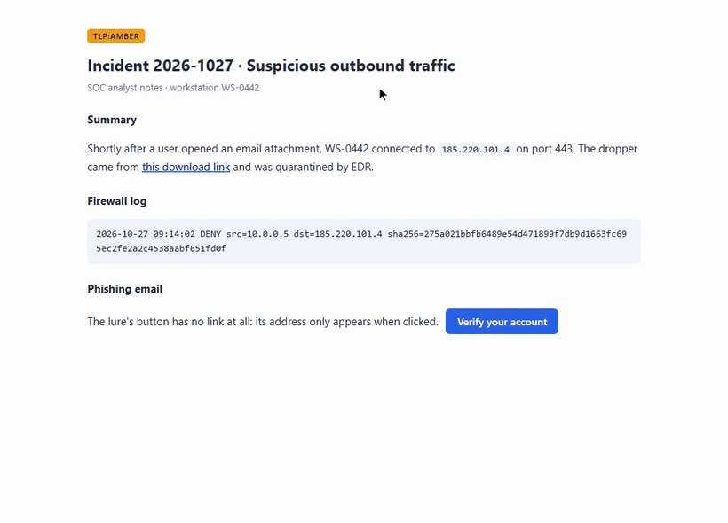
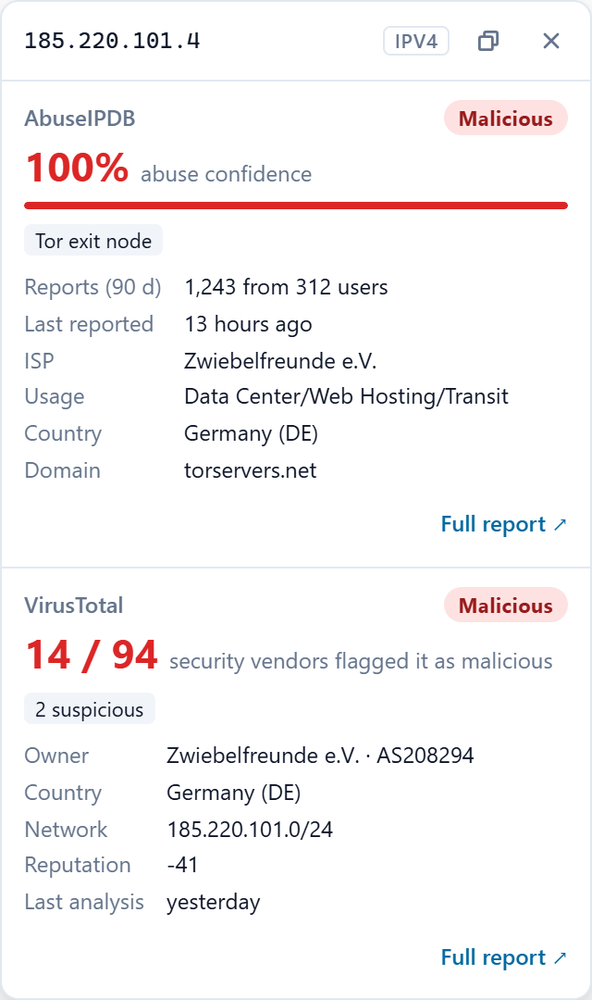
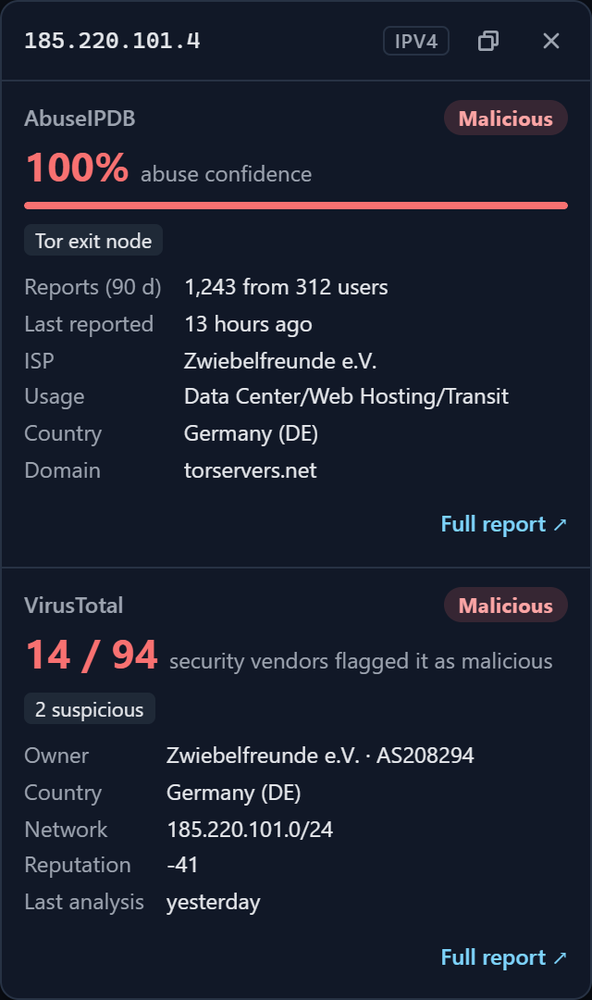
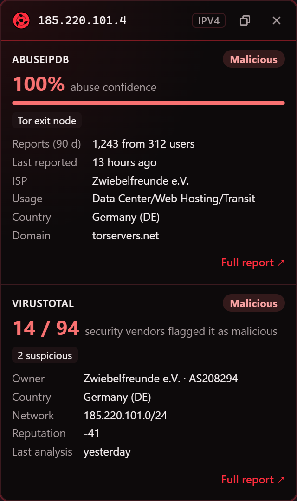
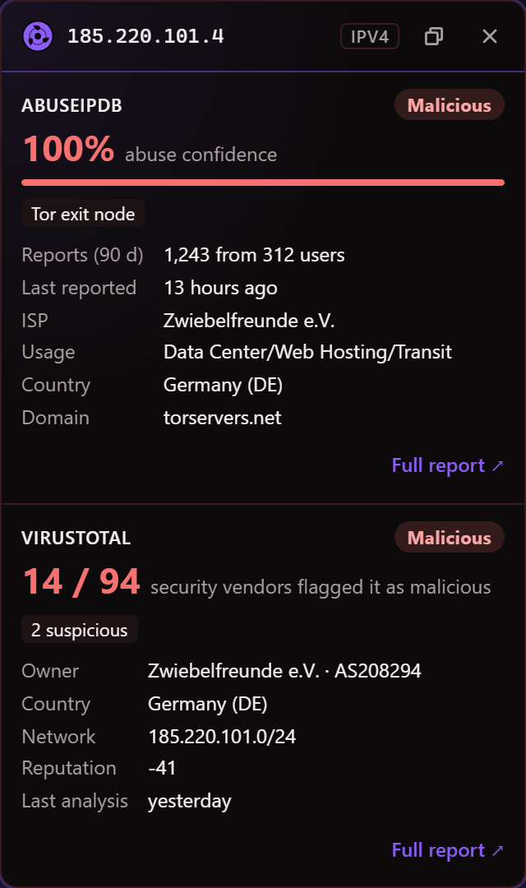
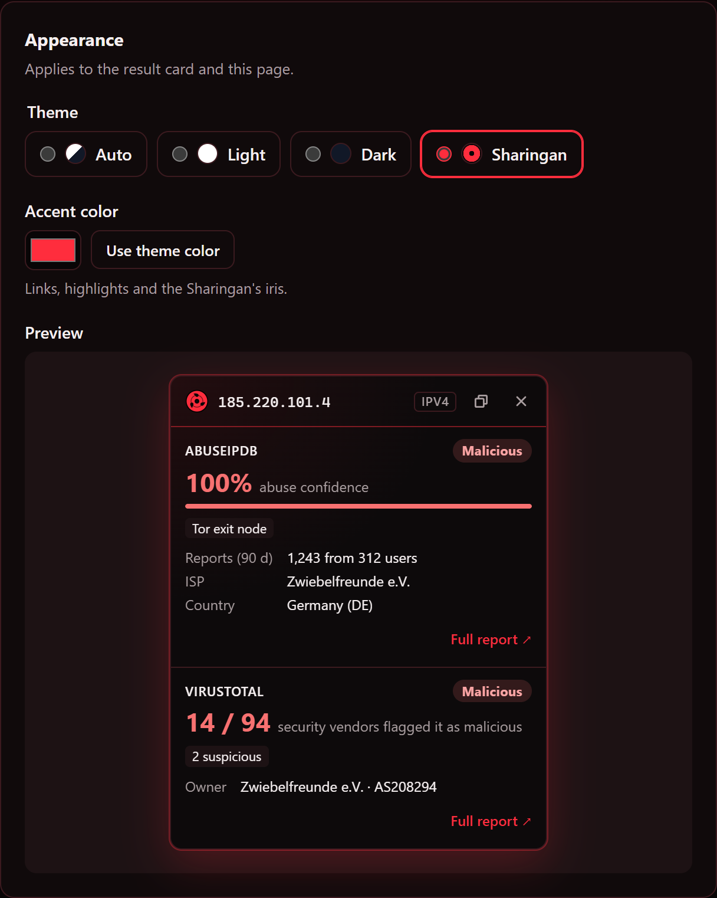
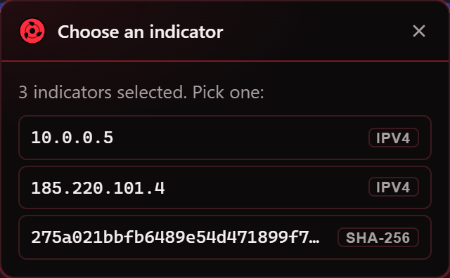

<div align="center">


# 4NTL

**Threat-intel lookups from the right-click menu.**
Select an IP, domain, URL or file hash, right-click, and see the **VirusTotal** and
**AbuseIPDB** verdicts right where you are. No more copy → new tab → paste → back.

[](https://github.com/boode-hub/4ntl/actions/workflows/ci.yml)


[](LICENSE)



</div>

## Why

During an investigation you touch dozens of IPs and hashes. Each one used to
mean: copy, open VirusTotal, paste, enter, read, go back, repeat for AbuseIPDB.
4NTL turns that into one right-click, and keeps you on the page you were reading.

## Features

- **One click, or one key.** Right-click → **4NTL** → AbuseIPDB, VirusTotal or
  **All providers**. Or select and press **Alt+Shift+L**.
- **Any link, button or card.** Right-click a link → **4NTL: check this link**, or
  a button, card or image → **4NTL: check what this opens**. 4NTL finds the
  destination even when the page hides it in JavaScript. If a button only gets an
  address when clicked, click it once: 4NTL catches where it was going and **stops
  it from opening**.
- **Unwraps protected links.** Outlook Safe Links, Proofpoint URL Defense, Barracuda,
  Google, Facebook, YouTube, Slack and LinkedIn redirects are looked up as the real
  destination.
- **Toolbar and address bar.** Click the 4NTL icon to check the page you're on, or
  type `4ntl` + space in the address bar followed by any link or indicator.
- **Reads analyst text.** Defanged IOCs (`1.2.3[.]4`, `hxxps://evil[.]com`),
  `ip:port`, `[IPv6]:port`, `src=1.2.3.4` log fields, quotes and brackets.
  Select a whole log line and it lets you pick the indicator.
- **IPv4, IPv6, domains, URLs, MD5, SHA-1, SHA-256.** AbuseIPDB checks IPs;
  VirusTotal checks everything.
- **Saves your quota.** Results are reused for 30 minutes (configurable, memory only),
  and identical requests are never sent twice.
- **Private by default.** Private and reserved IPs (10/8, 192.168/16, fe80::/10, …)
  and internal hosts (`intranet`, `*.corp`, `*.internal`, `*.local`, …) are never sent
  anywhere, even when you right-click a link to them. API keys stay in your browser profile.
- **Light.** Nothing runs on a page until you use 4NTL there. No background
  polling, no runtime dependencies.
- **Out of your way.** The card opens about 5 cm beside the pointer, so it never
  covers what you clicked, and you can drag it anywhere by its header.
- **Themes.** Auto, Light, Dark and **Sharingan**, plus any accent color you like.
- **Works everywhere.** On browser pages, the PDF viewer or the Web Store the
  result opens in a small window instead.

## Themes

|                                 Light                                 |                                Dark                                 |                                   Sharingan                                   |                                          Sharingan, custom color                                          |
| :-------------------------------------------------------------------: | :-----------------------------------------------------------------: | :---------------------------------------------------------------------------: | :-------------------------------------------------------------------------------------------------------: |
|  |  |  |  |

Pick a theme and accent color in the settings and see it live before you use it.
In the Sharingan theme the eye spins while results are loading.



## Install

Works in Chrome, Edge, Brave and other Chromium browsers (version 123+).

1. Download the latest `4ntl-vX.Y.Z.zip` from
   [Releases](https://github.com/boode-hub/4ntl/releases/latest) and unzip it into
   a folder you'll keep.
2. Open `chrome://extensions` (Edge: `edge://extensions`, Brave: `brave://extensions`).
3. Turn on **Developer mode**, click **Load unpacked**, and pick that folder.
4. The settings page opens: paste your API keys and press **Test** next to each.
   Later, open it again by right-clicking the 4NTL icon → **Options**.

Free API keys: [VirusTotal](https://www.virustotal.com/gui/my-apikey) (4 lookups/min,
500/day) · [AbuseIPDB](https://www.abuseipdb.com/account/api) (1,000 checks/day).

## Using it

| To check…                      | Do this                                                                   |
| ------------------------------ | ------------------------------------------------------------------------- |
| An IP, hash, domain or URL     | Select it → right-click → **4NTL** → a provider or **All providers**      |
| The same, faster               | Select it → **Alt+Shift+L**                                               |
| A link                         | Right-click it → **4NTL: check this link**                                |
| A button, card or image        | Right-click it → **4NTL: check what this opens** (then click it if asked) |
| The page you're on             | Click the **4NTL** toolbar icon                                           |
| Something you copied elsewhere | Address bar: type `4ntl`, a space, paste it, press **Enter**              |

Read the verdict. **Full report ↗** opens the provider's page; **Esc** or a click
elsewhere closes the card; the copy button copies the cleaned-up indicator.

Several indicators in one selection? You get a list to pick from:



| Verdict        | VirusTotal                               | AbuseIPDB                  |
| -------------- | ---------------------------------------- | -------------------------- |
| **Malicious**  | 3 or more vendors flag it malicious      | abuse confidence 75–100%   |
| **Suspicious** | 1–2 malicious, or any suspicious         | abuse confidence 25–74%    |
| **Clean**      | analysed, nothing flagged                | abuse confidence below 25% |
| **Unknown**    | VirusTotal has never seen or analysed it | —                          |

The raw numbers are always shown next to the verdict.

## Privacy and security

- Only `virustotal.com` and `abuseipdb.com` can be contacted, enforced by the
  extension's permissions and its Content-Security-Policy.
- 4NTL never submits anything for analysis; it only reads existing reports.
- The page-side card never sees your API keys, and renders API data as plain text only.
- No analytics, no telemetry, no third-party code.

Details in [SECURITY.md](SECURITY.md).

## Development

Requires Node.js 22+.

```bash
npm install
```

```bash
npm run dev
```

`npm run dev` rebuilds `dist/` on every change; load `dist/` as an unpacked extension.

| Command                 | What it does                                                     |
| ----------------------- | ---------------------------------------------------------------- |
| `npm run build`         | Production build into `dist/`, plus release checks               |
| `npm test`              | Unit tests (Vitest)                                              |
| `npm run test:coverage` | Unit tests with coverage thresholds (90%)                        |
| `npm run e2e`           | End-to-end tests in real Chromium with the extension loaded      |
| `npm run check`         | Everything CI runs, except e2e                                   |
| `npm run try`           | Opens a browser with 4NTL and a demo page, for trying it by hand |
| `npm run demo`          | Regenerates the GIF and screenshots in `docs/media`              |
| `npm run package`       | Builds and zips `4ntl-vX.Y.Z.zip` for release                    |

First-time e2e setup: `npm run e2e:install`. If your machine blocks programs in
`%LOCALAPPDATA%`, set `PLAYWRIGHT_BROWSERS_PATH` to a folder that's allowed
(for example `.cache/ms-playwright`, which git ignores) before installing and running.
`npm run demo` also needs `ffmpeg` on your PATH for the GIF.

Every push runs lint, type-check, ~380 unit tests and the end-to-end suite in
GitHub Actions; tagging `vX.Y.Z` publishes a release with the zip attached.

More: [architecture](docs/ARCHITECTURE.md) · [adding a provider](docs/ADDING_A_PROVIDER.md) ·
[roadmap](docs/NEXT.md) · [changelog](CHANGELOG.md)

## License and credits

[MIT](LICENSE) © 2026 Abdelrahman Khalid.

The Sharingan theme is a fan tribute to _Naruto_ by Masashi Kishimoto. 4NTL is not
affiliated with or endorsed by its rights holders, VirusTotal, or AbuseIPDB.
