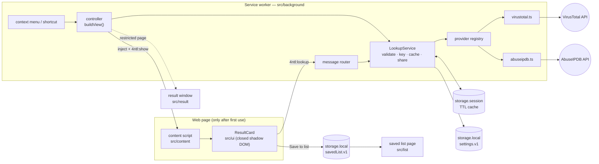

# Architecture

4NTL is a Manifest V3 extension written in TypeScript with **zero runtime
dependencies**. esbuild bundles four entry points; everything else is plain
modules with injected dependencies so the logic is testable without a browser.

## Components

## A lookup, step by step

1. The user selects text and picks **4NTL ▸ VirusTotal** (or presses the shortcut).
2. The service worker turns the selection into a `CardView` (`background/view.ts`):
   one indicator, a choice between several, or a notice.
3. It **starts the API requests immediately** and, in parallel, makes sure the
   content script is in the page (`ping`, inject only if there is no answer).
4. The content script renders the card next to the pointer (or the selection)
   and asks the service worker for each provider's result.
5. Those requests join the ones already in flight (`LookupService` shares one
   call per provider + indicator, and keeps a settled outcome for 5 s so a
   failure is not retried behind the user's back).
6. Each section of the card updates independently as its result arrives.

If the page can't be scripted (browser pages, PDF viewer, Web Store), the same
card opens in a small popup window instead.

## Key decisions

| Decision                                                                         | Why                                                                                                                                                                                                                             |
| -------------------------------------------------------------------------------- | ------------------------------------------------------------------------------------------------------------------------------------------------------------------------------------------------------------------------------- |
| **No declared content scripts**; inject on demand with `activeTab` + `scripting` | Zero cost on pages where 4NTL isn't used, and no "read and change all your data on all websites" permission.                                                                                                                    |
| **API keys and network calls live only in the service worker**                   | The page-side script never sees a key; it can only ask for lookups of indicators the worker re-validates.                                                                                                                       |
| **Providers are pure translators** (`Provider` interface)                        | A provider maps one API to the provider-agnostic `Report`. Caching, keys, errors and UI are shared, so adding a source is one file.                                                                                             |
| **Cache in `chrome.storage.session`**                                            | In memory only (never on disk), survives the worker being shut down after 30 s idle, wiped when the browser closes. Bounded to 500 entries. Cleared when settings change.                                                       |
| **Private/reserved IPs are rejected before any request**                         | They can't have reputation data, and sending them would leak internal network details.                                                                                                                                          |
| **The card uses a closed shadow root, and text only**                            | Page CSS can't break it, page scripts can't read it, and API data can never become markup (`innerHTML` is banned by lint). Positioning uses CSSOM, which page CSP doesn't block.                                                |
| **Themes are CSS only**                                                          | Colors are defined once with `light-dark()`; a theme just sets `color-scheme` (Sharingan adds its own palette). The worker sends the appearance with each card, and the accent is validated as `#rrggbb` before it reaches CSS. |
| **Flags from a bundled font, registered from bytes**                             | Windows has no flag emoji. A flags-only Twemoji font (78 KB) is inlined and added with `new FontFace(bytes)`, so page CSP, web-accessible resources and fingerprinting don't come into it.                                      |
| **No timers, alarms or keep-alives in the worker**                               | The browser can suspend it whenever it's idle.                                                                                                                                                                                  |
| **Manifest generated in code** (`scripts/manifest.mjs`)                          | Per-target differences (Chromium, Firefox, e2e) live in one place. A release guard (`scripts/verify-dist.mjs`) rejects any build with test hooks or broad host access.                                                          |

## Testing strategy

- **Unit (Vitest, ~360 tests, ≥90% coverage enforced):** parser edge cases,
  IP range tables, provider mapping against recorded API responses
  (`tests/fixtures`), error mapping, caching/sharing policy, the card's DOM
  (happy-dom), positioning math.
- **End-to-end (Playwright, real Chromium):** loads the e2e build, fakes the
  provider APIs inside the service worker, and drives real pages served with a
  strict CSP: lookups, choices, private IPs, retry, settings, keyboard shortcut,
  fallback window. Browser UI like the context menu can't be automated, so the
  e2e build exposes a hook (`__4ntl`) that enters at the same point a menu click
  does; release builds compile it out.
